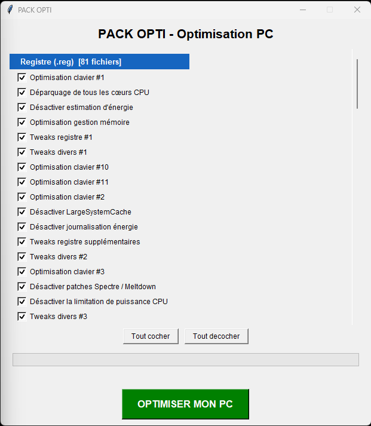
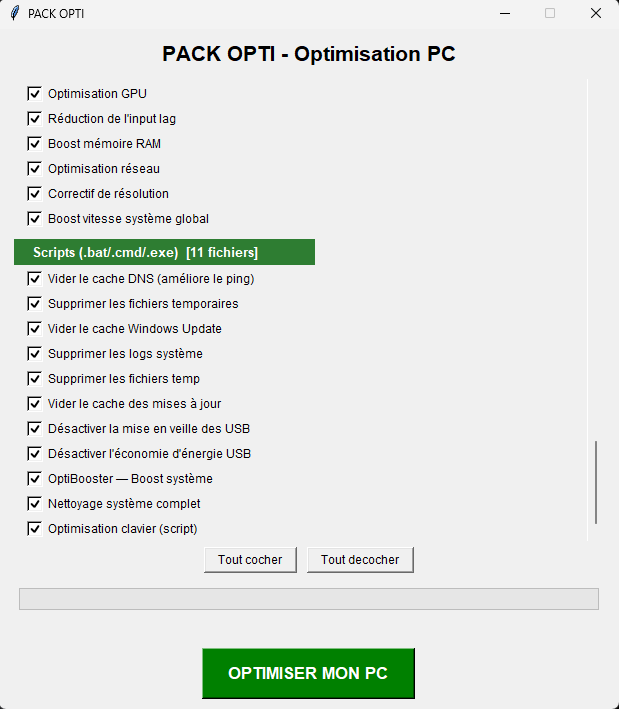
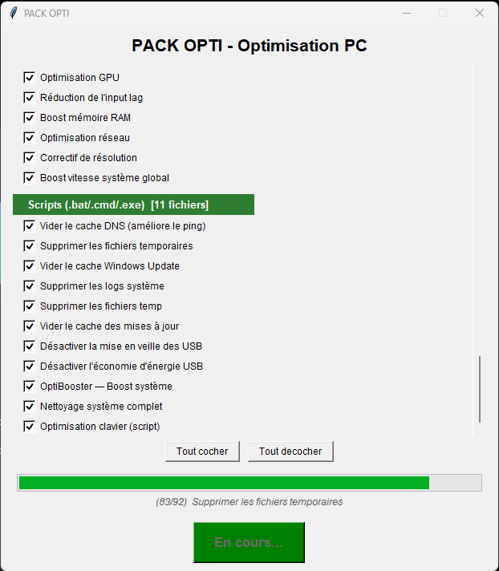
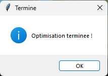

# Windows Tweaks Manager

Un logiciel qui applique une sélection de tweaks du registre Windows et de scripts de nettoyage depuis une seule fenêtre, au lieu de lancer des dizaines de fichiers `.reg` et `.bat` un par un.

Écrit en Python avec tkinter, et distribué sous forme d'exécutable autonome compilé avec PyInstaller, pour qu'il tourne sur une machine où Python n'est pas installé.



## Pourquoi ce projet

C'est un projet personnel. J'avais accumulé beaucoup de scripts d'optimisation, et les appliquer voulait dire ouvrir des dizaines de fichiers un par un, à chaque réinstallation de Windows. Je voulais une seule fenêtre où je choisis ce que je veux, j'appuie sur un bouton, et ça se fait tout seul, configuré comme j'aime travailler.

## État du projet

En construction. Le logiciel est utilisable, mais il n'est pas fini et ce n'est pas le but : je continue d'ajouter des tweaks, de renommer des entrées et d'améliorer l'interface au fur et à mesure. Il va donc continuer d'évoluer.

## Ce qu'il fait

- Il parcourt son propre dossier à la recherche des fichiers `.reg`, `.bat` et `.cmd`, et les range en deux sections : les tweaks du registre et les scripts de nettoyage.
- Il affiche chaque fichier sous forme de case à cocher avec un nom lisible, tout est coché par défaut, et on décoche ce qu'on ne veut pas.
- Il exécute les fichiers sélectionnés dans un thread, pour que la fenêtre reste utilisable pendant le traitement.
- Il affiche une barre de progression et le nom de l'élément en cours.
- Il se relance automatiquement en administrateur, ce qu'exigent les modifications du registre.

## Aperçu

Les scripts de nettoyage, dans la deuxième section de la liste :



Pendant l'exécution, la barre de progression avance et le nom de l'élément en cours s'affiche dessous. La fenêtre reste utilisable, puisque le traitement tourne dans un thread :



Et à la fin :



## Comment ça marche

| Partie | Détail |
|---|---|
| Élévation | `ctypes.windll.shell32.IsUserAnAdmin()` pour vérifier, puis `ShellExecuteW(..., "runas", ...)` pour relancer |
| Fichiers du registre | appliqués silencieusement avec `regedit /s` |
| Scripts | les lignes `pause` sont retirées, le script est réécrit dans un fichier temporaire puis lancé par `cmd /c`, sans fenêtre console et avec un délai maximum de 15 secondes |
| Compilation | `sys._MEIPASS` est testé pour que le même code retrouve ses fichiers, qu'il tourne en `.py` ou depuis l'exécutable PyInstaller |
| Encodages | les `.reg` arrivent en UTF-16, UTF-8 avec BOM ou Latin-1, donc chaque fichier est essayé avec plusieurs encodages |

## Organisation des fichiers

```
opti_manager.py     le logiciel
registry/           les tweaks .reg, appliqués avec regedit /s
scripts/            les scripts de nettoyage .bat et .cmd
launcher.bat        lanceur de secours, démarre le script en administrateur
```

## Pré-requis

- Windows 10 ou 11
- Python 3.13 ou plus récent avec tkinter, uniquement pour lancer le code source (l'exécutable publié a été compilé avec Python 3.15 et PyInstaller 6.22.3)
- Les droits administrateur

## Utilisation

Depuis le code source :

```bash
python opti_manager.py
```

Pour recompiler l'exécutable autonome :

```bash
pyinstaller --noconfirm --onefile --windowed ^
  --add-data "registry;registry" ^
  --add-data "scripts;scripts" ^
  --name "PACK OPTI" opti_manager.py
```

L'exécutable compilé est publié dans les [Releases](../../releases) plutôt que dans le dépôt.

## Avertissement

Ces tweaks modifient le registre et les services de Windows. Certains échangent de la sécurité contre de la performance : désactiver l'UAC, VBS ou les correctifs Spectre et Meltdown rend la machine nettement plus exposée. Lis ce que fait un tweak avant de l'appliquer, décoche ceux dont tu ne veux pas, et crée un point de restauration avant :

```
Panneau de configuration > Système > Protection du système > Créer
```

Ce projet est fourni tel quel, sans garantie. Tu l'utilises à tes risques.

## Crédits

Une partie des tweaks du registre vient de packs d'optimisation partagés publiquement par la communauté Windows ; le crédit d'origine est conservé dans le nom des fichiers quand il y figurait. Le logiciel, le nommage des fichiers, les libellés et la compilation sont de moi.
